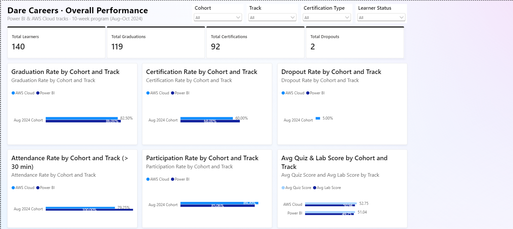
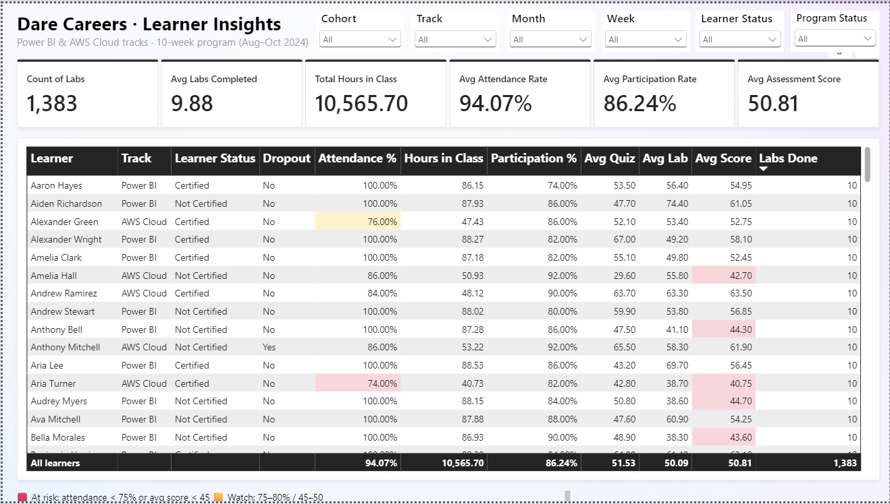
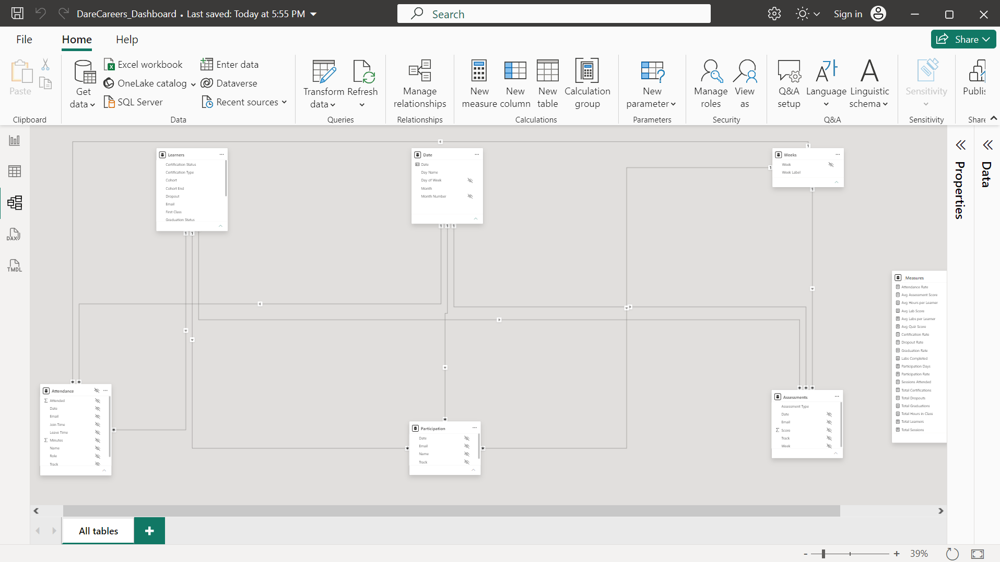

# Dare Careers – Learner Progress & Performance Dashboard (Power BI)

DEM08 lab: a two-page Power BI report that tracks attendance, participation, assessments and outcomes for Dare Careers' **Power BI** and **AWS Cloud** training tracks.




## Repository structure
```
dare-careers-powerbi-dashboard/
├── README.md
├── .gitignore                  # raw data, temp and system files are not committed
├── report/
│   └── DareCareers_Dashboard.pbix
├── docs/
│   ├── data_notes.md           # files, data quality issues, decisions
│   ├── power_query.md          # all M code
│   ├── dax_measures.md         # all 19 measures + expected results
│   ├── test_results.md         # 12 test cases (12/12 passed)
│   ├── data_model.png          # star schema
│   └── screenshots/
└── data/raw/                   # NOT committed – place the dataset here
```

## Requirements
- Windows with **Power BI Desktop 2.159.1231.0 (64-bit)** or newer
- The Dare Careers dataset (provided by the instructor)

## How to open and refresh
1. Open `report/DareCareers_Dashboard.pbix`. The data is already loaded, so the report works without the raw files.
2. To refresh from the raw files:
   - Copy the dataset into `data/raw/` (folders `Cloud Training` and `PowerBI Training`).
   - In Power BI: **Home → Transform data → DataFolder** → set the path to your `data\raw` folder (no trailing `\`).
   - **Close & Apply**, then **Home → Refresh**.

## Data
| Source | Per track | Layout |
|---|---|---|
| Zoom Attendance | 50 daily CSVs in `Week 1`–`Week 10` folders | one row per learner per day |
| Labs & Quizzes | 1 Excel file (sheets Labs, Quizzes) | wide: `Week 1`…`Week 10` columns |
| Participation | 1 Excel file | one row per day, names comma-separated |
| Status of Learners | 1 Excel file | one row per learner |

**Data quality issues fixed in Power Query:** Duration in minutes (`66`) vs `h:mm:ss` text (`1:46:00`); 24-hour vs AM/PM times; different file and sheet names per track; track, date and week only in folder/file names; participation identified by name, not email. Details: [docs/data_notes.md](docs/data_notes.md).

## Data model
Star schema: 3 dimensions (**Learners**, **Date**, **Weeks**) each related 1:* (single direction) to 3 facts (**Attendance**, **Participation**, **Assessments**). Measures live in a separate `_Measures` table.



| Table | Grain | Rows |
|---|---|---|
| Learners | one learner | 140 |
| Attendance | learner × class day | 7,000 |
| Participation | learner × day participated | 6,037 |
| Assessments | learner × week × Lab/Quiz | 2,800 |
| Date | calendar day | 68 |
| Weeks | program week | 10 |

## Business rules
| Rule | Definition |
|---|---|
| Attended | Zoom session **> 30 minutes** (exactly 30 = not attended) |
| Cohort | Derived from each learner's first class month → "Aug 2024 Cohort"; one cohort, two tracks; new intakes are labelled automatically |
| Certification Type | AWS (AWS Cloud track) / Power BI (Power BI track) |
| Truncated attendance | Last attended session is before the cohort/track's final class day |
| Dropout | Non Graduate **AND** Not Certified **AND** truncated attendance |
| Program Status | Completed once the cohort/track's last class date has passed (program-level, not the learner's outcome) |
| Total Hours in Class | Only attended sessions (> 30 min) |
| Labs Completed | Lab score > 0 (zero scores still count as 0 in averages) |
| At-risk (Page 2 colours) | Red: attendance < 75% or avg score < 45 · Amber: 75–80% / 45–50 |

Built for future cohorts: Track/Data Type are read anywhere in the folder path, lookups use cohort-safe keys (Track + Date + Name, Email + Week), and the Week slicer uses the program week, not the calendar week.

## Measures
19 DAX measures in 5 display folders (Counts, Rates, Attendance, Participation, Assessments). Base measures are reused (e.g. `[Total Learners]`), `KEEPFILTERS` respects slicers and `DIVIDE` handles division by zero. Code and expected values: [docs/dax_measures.md](docs/dax_measures.md).

## Report pages
| Page | Visuals | Slicers |
|---|---|---|
| **Overall Performance** | 4 cards (learners, graduations, certifications, dropouts); 6 bar charts by cohort and track (graduation, certification, dropout, attendance, participation, quiz & lab scores) | Cohort, Track, Certification Type, Learner Status |
| **Learner Insights** | 6 cards (count of labs, avg labs, hours, attendance, participation, avg score); learner table with at-risk highlighting | Cohort, Track, Month, Week, Learner Status, Program Status |

Cohort, Track and Learner Status slicers are synced across both pages.

## Testing
12 test cases (slicer combinations, a single learner, no-data case, slicer sync, full refresh) – **12/12 passed**. See [docs/test_results.md](docs/test_results.md).

## Key findings
| Metric | AWS Cloud | Power BI | Total |
|---|---|---|---|
| Learners | 40 | 100 | 140 |
| Graduation rate | 82.50% | 86.00% | 85.00% |
| Certification rate | 60.00% | 68.00% | 65.71% |
| Dropouts (rate) | 2 (5.00%) | 0 (0.00%) | 2 (1.43%) |
| Attendance rate (> 30 min) | 79.25% | 100.00% | 94.07% |
| Participation rate | 89.20% | 85.06% | 86.24% |
| Avg assessment score | 51.85 | 50.40 | 50.81 |

- **Attendance vs participation:** AWS Cloud learners attended less (79.25%) but participated more (89.20%) than Power BI learners.
- **Labs:** 1,383 of 1,400 labs completed (98.8%); quizzes average slightly higher than labs (51.53 vs 50.09).
- **At-risk:** 7 learners (all AWS Cloud) attended < 75% of sessions; 32 averaged < 45; 3 are on both lists (Aria Turner, John Miller, Nicholas Allen).
- **Dropouts were late, not gradual:** both dropouts (AWS Cloud) had high attendance (86%, 90%) and participation (92%, 94%) and stopped attending only in the final days.
- No Non Graduate was certified.

## Deliverables
| Brief requirement | Where |
|---|---|
| Page 1 bar charts (graduation, certification, dropout, attendance, participation, scores) | `report/…pbix` → Overall Performance |
| Page 1 cards and slicers | Overall Performance |
| Page 2 learner table, 6 cards, 6 slicers | Learner Insights |
| 30-minute attendance rule | Power Query `Attendance[Attended]`; [power_query.md](docs/power_query.md) |
| Data preparation and cleaning | [power_query.md](docs/power_query.md), [data_notes.md](docs/data_notes.md) |
| DAX for attendance %, averages, certification and graduation rates | [dax_measures.md](docs/dax_measures.md) |
| Relationships between Attendance, Participation, Labs, Quizzes, Learner Status | [data_model.png](docs/data_model.png) |

## Limitations and next steps
- The dataset has one cohort, so cohort comparisons show a single group until new intakes are added.
- Certification Type follows the track (one certification per track).
- At-risk thresholds (75% / 45) are design choices and can be adjusted.
- The `.pbix` stores a compressed copy of the loaded data; raw files are kept out of Git.

---
Author: David Kamanda · AmaliTech training · DEM08: Business Intelligence and Dashboarding with Power BI